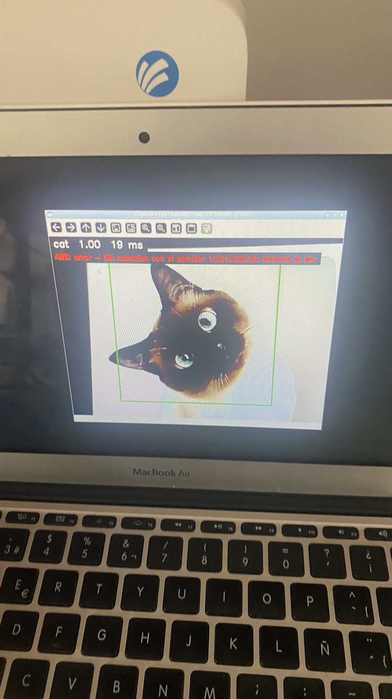
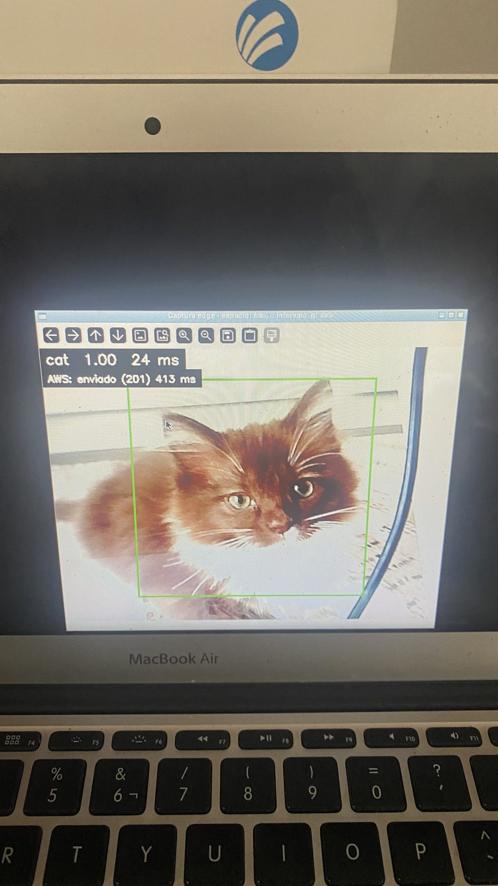

# EDG-6 — Pruebas de operación en la laptop edge

**Criterio del ticket:** las tres pruebas pasan en la laptop edge y quedaron anotadas con hora y
resultado.

Pasos: [`docs/p4/pruebas-operacion.md`](../../docs/p4/pruebas-operacion.md) (con la tabla de
resultados llena). Código de operación continua: [`edge/operation.py`](../../edge/operation.py)
y [`edge/capture.py`](../../edge/capture.py).

Todo el 2026-10-13, horas en UTC, en la consola física de la laptop (`run_display.sh`), con la
variante **`int8-rr`** (SHA-256 `1d4a85fa…`) y envío al endpoint real de Capturas Edge.

| Prueba | Inicio | Fin | Resultado |
|---|---|---|---|
| 1. Cinco minutos continuos | 22:34:04 | 22:39:46 | ✅ 35 capturas, 35/35 enviadas, 0 errores, memoria 153.7 → 154.0 MB |
| 2. Red apagada | 22:43:18 | 22:45:04 | ✅ 4 capturas clasificadas sin red; error visible; reenviadas con el mismo ID, 1 registro cada una |
| 3. Reinicio del programa | 22:45:34 | 22:46:11 | ✅ el historial se conserva (44 eventos al reabrir) y la captura nueva se clasifica y envía |

Archivos de esta carpeta:

| Archivo | Qué es |
|---|---|
| [`edge.log`](edge.log) | Registro local de las tres sesiones (`logs/edge.log` de la laptop) |
| [`eventos.json`](eventos.json) | Historial completo exportado con `export_events.py` (45 eventos, todos `enviado`) |
| [`contraste_local_vs_aws.txt`](contraste_local_vs_aws.txt) | Cada evento local contra `GET /api/edge-captures` |
| [`capturas/`](capturas/) | Las 41 fotos de hoy, con el `capture_id` en el nombre |
| [`prueba1_hoja_capturas.jpg`](prueba1_hoja_capturas.jpg) | Las 35 fotos de la prueba 1 con su predicción |
| [`pantalla/`](pantalla/) | Fotos del celular de la ventana (sin metadatos ni ubicación) |

## Prueba 1 — Cinco minutos continuos

Captura por intervalo (`i`, cada 10 s) de 22:34:04 a 22:39:46 (5 min 42 s), cambiando fotos de
perros y gatos frente a la cámara. Del registro:

```
22:34:04 INFO Captura por intervalo ACTIVADA: cada 10 s (i para detener).
22:34:34 INFO Estado: 4 capturas en esta sesion, memoria del proceso 153.7 MB
22:35:34 INFO Estado: 10 capturas en esta sesion, memoria del proceso 153.8 MB
22:36:34 INFO Estado: 16 capturas en esta sesion, memoria del proceso 153.9 MB
22:37:34 INFO Estado: 22 capturas en esta sesion, memoria del proceso 154.0 MB
22:38:34 INFO Estado: 28 capturas en esta sesion, memoria del proceso 154.0 MB
22:39:34 INFO Estado: 34 capturas en esta sesion, memoria del proceso 154.0 MB
22:39:46 INFO Captura por intervalo detenida.
```

35 capturas, las 35 enviadas a AWS (HTTP 201), ninguna línea `ERROR` y la memoria estable (+0.3 MB
en seis minutos).

**Aciertos y errores (revisión visual de las 35 fotos).** El intervalo dispara cada 10 s aunque
se esté cambiando de foto, así que 8 capturas no tienen un animal claro dentro del recuadro; se
clasificaron y enviaron igual. De las **27 con un animal encuadrado (15 perros, 12 gatos), 25 son
correctas**. Los dos errores son un perro movido (`cat 0.68`) y un gato persa (`dog 0.74`), ambos
con confianza baja. La calidad cuantitativa del modelo se mide en la validación etiquetada
(MOD-4: 126/128 en esta laptop); estas capturas verifican la operación.

| # | Hora (UTC) | En la foto | Predicción | Confianza | Resultado |
|---|---|---|---|---|---|
| 1 | 22:34:04 | perro | dog | 1.00 | ✅ |
| 2 | 22:34:14 | gato | cat | 1.00 | ✅ |
| 3 | 22:34:24 | sin animal claro (cambio de foto) | cat | 0.97 | — |
| 4 | 22:34:34 | perro (perro muy de cerca) | dog | 1.00 | ✅ |
| 5 | 22:34:44 | gato | cat | 1.00 | ✅ |
| 6 | 22:34:54 | perro | dog | 1.00 | ✅ |
| 7 | 22:35:04 | sin animal claro (cambio de foto) | cat | 0.98 | — |
| 8 | 22:35:14 | perro (perro movido) | cat | 0.68 | ❌ |
| 9 | 22:35:24 | perro (perro movido) | dog | 0.50 | ✅ |
| 10 | 22:35:34 | sin animal claro (cambio de foto) | cat | 0.92 | — |
| 11 | 22:35:44 | gato | cat | 1.00 | ✅ |
| 12 | 22:35:54 | perro | dog | 0.99 | ✅ |
| 13 | 22:36:04 | sin animal claro (cambio de foto (gato fuera del recuadro)) | dog | 0.62 | — |
| 14 | 22:36:14 | gato | cat | 0.99 | ✅ |
| 15 | 22:36:24 | perro | dog | 1.00 | ✅ |
| 16 | 22:36:34 | sin animal claro (cambio de foto) | cat | 0.91 | — |
| 17 | 22:36:44 | perro | dog | 1.00 | ✅ |
| 18 | 22:36:54 | gato | cat | 0.93 | ✅ |
| 19 | 22:37:04 | sin animal claro (cambio de foto) | cat | 0.85 | — |
| 20 | 22:37:14 | perro | dog | 1.00 | ✅ |
| 21 | 22:37:24 | gato | cat | 0.94 | ✅ |
| 22 | 22:37:34 | sin animal claro (cambio de foto) | cat | 0.95 | — |
| 23 | 22:37:44 | perro | dog | 0.76 | ✅ |
| 24 | 22:37:54 | gato | cat | 1.00 | ✅ |
| 25 | 22:38:04 | perro | dog | 0.99 | ✅ |
| 26 | 22:38:14 | gato | cat | 1.00 | ✅ |
| 27 | 22:38:24 | perro | dog | 1.00 | ✅ |
| 28 | 22:38:34 | sin animal claro (cambio de foto (gato fuera del recuadro)) | dog | 0.97 | — |
| 29 | 22:38:44 | gato | cat | 1.00 | ✅ |
| 30 | 22:38:54 | perro | dog | 1.00 | ✅ |
| 31 | 22:39:04 | gato | cat | 1.00 | ✅ |
| 32 | 22:39:14 | perro | dog | 1.00 | ✅ |
| 33 | 22:39:24 | gato (gato persa) | dog | 0.74 | ❌ |
| 34 | 22:39:34 | gato | cat | 0.68 | ✅ |
| 35 | 22:39:44 | perro | dog | 1.00 | ✅ |

## Prueba 2 — Red apagada

La laptop no tiene wifi: la red es el adaptador USB-Ethernet. Del registro del kernel:

```
22:43:18 kernel: usb 2-1: USB disconnect, device number 3          <- adaptador desconectado
22:45:04 kernel: cdc_ncm 2-1:2.0 enx9c69d3be1ac7: renamed from eth0 <- reconectado
```

| Hora | Red | Clase | Envío |
|---|---|---|---|
| 22:43:06 | con red | dog 1.00 | enviado (HTTP 201, 355 ms) |
| 22:43:30 | **sin red** | dog 1.00 (23.4 ms) | error: `Sin conexion con el servidor 18.216.36.30: Network is unreachable` |
| 22:43:44 | **sin red** | dog 1.00 (25.1 ms) | error: igual |
| 22:44:07 | **sin red** | cat 0.99 (20.5 ms) | error: igual |
| 22:44:44 | **sin red** | cat 1.00 (19.5 ms) | error: igual |



Al reconectar, `retry.py --todos` envió las cuatro con su mismo `capture_id`:

```
0099abd8-b6e9-456d-9f1b-a5e07bd99b49  dog  enviado (HTTP 201, nuevo, 416 ms)
725652b9-fcc0-4e33-a109-4f72a2bb8523  dog  enviado (HTTP 201, nuevo, 334 ms)
4f85b015-6590-467b-829f-cc5e89925ce6  cat  enviado (HTTP 201, nuevo, 414 ms)
77884b45-ba0b-40c5-8b84-5f0388bbaa85  cat  enviado (HTTP 201, nuevo, 319 ms)

4/4 enviados. Historial: {'pendiente': 0, 'enviado': 45, 'error': 0}
```

## Prueba 3 — Reinicio del programa

Cada sesión empieza con el historial de la anterior (`Historial: … (N eventos)` en el registro):

| Sesión | Al arrancar | Capturas |
|---|---|---|
| 22:33:32 (prueba 1) | 4 eventos | 35 |
| 22:42:42 (prueba 2) | **39** = 4 + 35 | 5 |
| 22:45:34 (reinicio) | **44** = 39 + 5 | 1: `cat 1.00`, 24.0 ms, enviado (HTTP 201, 413 ms) |



## Historial local contra AWS

`contraste_local_vs_aws.txt`: los **45 eventos** del historial están en AWS **exactamente una vez**
y con los mismos metadatos (clase, confianza, `latency_ms`, dispositivo, versión del modelo,
`crop`, `image_key` y `captured_at`); no hay `capture_id` duplicados. Los 4 eventos del
2026-10-10 llevan `model_version` `…-int8` (la primera variante) y los 41 de hoy `…-int8-rr`.
